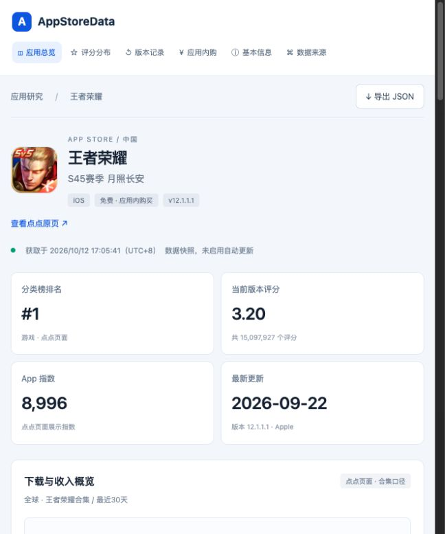

# AppStoreData
仿点点数据和七脉数据获取苹果商店应用关键运营数据

首版是王者荣耀中国区的真实数据展示页：应用信息、分类榜排名、评分分布、内购、版本记录和合集下载收入区间。点点数据来自用户登录后的页面快照；基础信息和截图同时获取自 Apple 公开接口。

新增 [美区工具畅销榜 Top 200](http://127.0.0.1:4173/us-utilities.html)：榜单来自 Apple iTunes Top Charts，评分和版本来自 Apple Lookup，全部无需登录。支持刷新，标注本次获取时间。

榜单页还展示 IOSMRR 公开快照中的 20 个应用月下载量及 Est. MRR（来源标记 2026-09，地区和方法未披露），以及 9 个应用的 Sensor Tower 全球摘要对照。另有 Appfigures 官方 CLI 获取的全球上月应用合并摘要，当前覆盖 174/200 个应用，收入为扣除平台费用后的估算。月度列计算可用点估算的算术均值；不同地区、月份、平台与收入定义未对齐。估算采集时间和限制在页面说明；刷新仅更新 Apple 数据。美国区、历史累计仍未取得。

新增 AppMagic 公开月榜范围，采集于 2026-10-14：2026-09、全球、所有商店合并。当前 Top 200 匹配月下载 25 个、月收入 82 个应用；收入为预计内购收入，扣除平台和税费。表格末尾显示 K/M/B 范围，保留 > / <，不参与点估算均值。原始公开行保存在 `data/appmagic-monthly-public-chart-rows.json`，通过 `python3 scripts/normalize_appmagic.py` 重建月度快照；刷新网页只更新 Apple 榜单，不重新采集 AppMagic。美国区及单独 iOS 筛选未取得公开数值。

前部月下载、月收入现显示四家美国推算值的算术均值，表尾分别显示 IOSMRR、Sensor Tower、Appfigures、AppMagic 美国推算。按用户指定，范围阈值也按数字参与，例如 ≈>$5.2M 取 5.2M；缺失不填零。其他三家原始值乘以 AppMagic 最近30天对应指标的美国占比，IOSMRR 地区未披露，假定全球；跨来源、月份、平台及税费定义未统一，均值是参考模型，不是三家直接提供的美国数据。当前覆盖下载 47/200、收入 83/200。见 [美国推算说明](docs/appmagic-monthly-public.md)。

## 本地运行

```sh
python3 server.py
```

打开 [本地网页](http://127.0.0.1:4173/)。支持评分口径切换、页面导航、描述展开和 JSON 导出。

榜单页：[http://127.0.0.1:4173/us-utilities.html](http://127.0.0.1:4173/us-utilities.html)。后台 `/api/us-utilities` 请求固定的 Apple 公共接口，缓存 5 分钟；点击刷新会重新获取。已有数据在请求失败时仍会显示，并明确标为快照。

单独获取榜单与执行口径校验：

```sh
python3 scripts/us_utilities.py
python3 -m unittest discover -s tests -v
```

[榜单接口说明](docs/us-utilities.md)。



## 数据与研究

- `data/diandian-page.json`：已登录点点页面的应用区域可见文本，无 Cookie/token。
- `data/apple-lookup.json`：Apple 公开 Lookup 的真实返回。
- `data/snapshot.json`：网页使用的结构化数据及来源、采集时间。
- [接口与 REA 研究记录](docs/research.md)。

从保留的原始数据重建当前快照：

```sh
python3 scripts/build_snapshot.py
```

此解析脚本只处理本次页面快照。合集口径、时间范围和涨跌方向通过原页截图核对；后续刷新需要重新采集并核对这些条件，不能直接用于任意应用或不同筛选状态。

这是本地快照版，未实现实时点点接口或自动更新。下载 `>100万`、收入 `>$1亿` 是“全球／王者荣耀合集／最近30天”的页面展示区间，非该单个 iOS 应用的精确数据。独立请求点点接口目前返回 `sign error`，完整时间序列及会员数据尚未获取。
